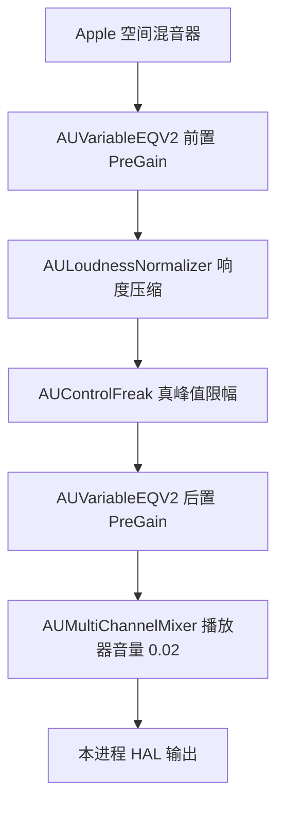

# AirPods Max 与普通耳机输出对照

实验日期：2026-10-24。系统：macOS 27.0.1（26A434），Apple Silicon。

**结论：相同 HRTF 和朝向下，两条路径的空间混音器输出逐样本相同。后续实验进一步定位了 HAL 差异：AirPods 路径在动态处理前后分别设置 −20／+20 dB，FIIO 则为 0／0 dB；匹配这两个参数后，已测 HAL PCM 也逐样本完全相同。产品现已通过高级面板提供按设备记忆的余量和 HRTF 手动选择，默认仍保留系统行为。正式模块验收见 [验证记录](VALIDATION.md)。**

## 条件与观察位置

- AirPods Max 为用户确认并佩戴的 `You Kant Listen`，普通耳机通过 FIIO KA11 输出；两者报告 48 kHz。用户截图显示 AirPods 为 USB 音频，CoreAudio transport 同时报告 `blue`；本实验不据此判定物理链路或编码。
- 用户已有全局个性化空间音频配置。实验未写系统设置、播放器偏好或产品源码。系统默认输出只记录，不主动改变。
- 独立 Objective-C AVPlayer 进程正常链接测试动态库，复用正式 `SpatialShim.c`、`HeadPose.c`、`Equalizer.c`。EQ 关闭，播放器音量为 0.02，朝向固定为单位四元数或 Z+45°。没有混合总线 tap，不改变原有音频块大小。
- AirPods 原生路径不启用能力伪装，成功报告 `overriddenQueries=0`；FIIO 使用项目原有能力兼容层。成功空间用例均为 `q_sp=1`。
- 同时观察 Apple AUSpatialMixer 的 PostRender 与**本进程**交给 HAL 的输出回调。保存的是两声道 Float32 PCM，采集期间在预分配内存中写入，停止后写文件；不录制麦克风、其他应用、USB/蓝牙线上数据或耳罩实际声学输出。
- 读取已初始化的 AudioUnit 属性：`3100` 输出类型、`3113` 个性化模式、`3116` 实际是否使用个性化 HRTF，以及 `3102` 朝向。`3113=1` 是请求，不能代替 `3116=1` 的实际状态。

## 实验设计

1. 生成 8 秒、48 kHz、16-bit WAVE_FORMAT_EXTENSIBLE 5.1 文件：六路不同的确定性宽频信号，包含静音前后段，LFE 限于 25–120 Hz。输入峰值低于满幅。
2. 原始 AirPods / FIIO 路径分别运行三次，另重复一次 FIIO 个性化对照。
3. 只对当前测试进程的混音器设置 `SpatialMixerPersonalizedHRTFMode`：FIIO 请求 On；AirPods 请求 Off；另测 FIIO Auto。系统个性化配置保持原样。
4. 补测固定 Z+45°、本机 Atmos 与 APAC 16 声道音乐的 30–37 秒片段。另用五倍幅度的 5.1 输入检查高峰值；该输入文件本身仍未削波。
5. 每对 PCM 用左右耳共用的整数偏移对齐。保留起始后 1 秒至结束前 0.5 秒的公共窗口，逐个 Float32 位模式比较。另报告单个共同增益拟合后的残差；不做独立声道 EQ、独立耳间延迟补偿或时间拉伸。
6. HAL 额外报告逐秒残差及捕获第 4–6 秒窗口，完整窗口指标仍保留。这个后段窗口用于观察起播暂态是否衰减，不能替代完整窗口结果。

## 结果

### 全局个性化设置与实际渲染

| 对照 | AirPods 实际个性化 | FIIO 实际个性化 | 空间混音器 PCM |
|---|---:|---:|---|
| 原始播放路径 | 1 | 0 | 不相同 |
| FIIO 实例显式请求 On | 1 | 1 | 完全相同 |
| AirPods 实例显式请求 Off | 0 | 0 | 完全相同 |
| FIIO 实例请求 Auto | — | 0 | 与 FIIO 原始路径完全相同 |

原始路径左右耳相关系数约为 **0.827**；允许一个共同增益后，差分 RMS 相对参考信号仍约为 **−5.00 dB**。差异不能用统一音量解释。

两条原始路径各自的重复抓取，在空间混音器和 HAL 两处都逐样本相同。重复 FIIO On 对照也逐样本相同，排除了把本轮差异简单归因于重复播放的随机波动。

### 相同 HRTF 的空间混音器输出

以下每行均为两耳、全部比较样本 **100% 位模式相同**，最大绝对差为 0，无需增益校正，所需时间偏移也均为 0：

| 场景 | 实际 HRTF | 比较帧数 | 比较时长 |
|---|---|---:|---:|
| 低电平 5.1，朝向 0° | 个性化 | 315,072 | 6.564 秒 |
| 低电平 5.1，朝向 0° | 通用 | 315,072 | 6.564 秒 |
| 低电平 5.1，Z+45° | 个性化 | 314,560 | 6.553 秒 |
| Atmos 音乐片段 | 个性化 | 266,944 | 5.561 秒 |
| APAC 16 声道音乐片段 | 个性化 | 266,944 | 5.561 秒 |
| 高峰值 5.1 | 通用 | 315,072 | 6.564 秒 |

成功用例没有捕获溢出、不支持格式、回调时间不连续或姿态应用错误。渲染与 HAL 块均为 512 帧。

### HAL 输出仍然不同

以下都已先确认空间混音器 PCM 相同。残差为两条 HAL 波形相减的 RMS 相对 FIIO 信号 RMS，**不是 dBFS，也不是主观可闻性结论**。

| 场景 | 完整比较窗口残差 | 第 4–6 秒残差 | 第 4–6 秒最大绝对样本差 |
|---|---:|---:|---:|
| 低电平 5.1，个性化，0° | −57.28 dB | −144.37 dB | 6.98 × 10⁻¹⁰ |
| 低电平 5.1，个性化，45° | −57.19 dB | −144.37 dB | 9.31 × 10⁻¹⁰ |
| Atmos 音乐片段 | −24.29 dB | −24.36 dB | 0.007633 |
| APAC 16 声道音乐片段 | −17.59 dB | −17.07 dB | 0.016409 |
| 高峰值 5.1，通用 | −9.70 dB | −7.48 dB | 0.008352 |

低电平信号的较大误差集中在起播阶段，随后下降至 Float32 舍入量级。音乐中的较大差异持续存在；拟合一个共同增益后也不能消除。

高峰值 5.1 的空间混音器峰值两边都为 **1.340219**。AirPods HAL 峰值为 **0.026804**，FIIO HAL 为 **0.019383**。Atmos 对照也出现原始空间样本超过 1、FIIO 后续峰值较低的现象。这些是未调整后级增益时的结果；具体原因和参数交换验证见下节。


## HAL 差异定位：动态处理前后的增益配置

扩展测试探针，在创建 Apple AudioUnit 实例时注册只读渲染观察器，同时读取组件名称、协商格式和参数名称／值。两条路径新增观察器前后的空间混音器及 HAL PCM 均逐样本相同，确认观察本身未改变本轮输出。所有比较仍为 48 kHz、512 帧块。

通过相邻阶段的 PCM 对齐，确认信号依次经过：



### 直接读到的配置差异

| 项目 | AirPods 原生路径 | FIIO 兼容路径 |
|---|---:|---:|
| 第一个 `AUVariableEQV2`，参数 7 `PreGain (dB)` | −20 dB | 0 dB |
| 第二个 `AUVariableEQV2`，参数 7 `PreGain (dB)` | +20 dB | 0 dB |
| `AULoudnessNormalizer` 的 `enable compressor` | 1 | 1 |
| `AUControlFreak` 的 `Enable limiter`／`TruePeak` | 1／1 | 1／1 |

两条路都运行动态处理，但进入它们的信号电平不同。AirPods 的前置 −20 dB 把幅度降为 0.1 倍，经过动态处理后再放大 10 倍。由于压缩与限幅并非线性运算，这两个方向相反的增益并不等价于不设置增益。

本轮 `AULoudnessNormalizer` 还报告 target loudness −12、downward compressor ratio 约 3、AGC 关闭、lookahead 3 ms；`AUControlFreak` 报告阈值 0 dB、lookahead 0.7 ms。相邻输出实测分别相差 **144 帧、34 帧**，总计 178 帧；这是两个处理阶段之间的样本偏移，不是动作到声音或整条设备链路的总延迟。

### 高峰值信号逐级验证

下面是同一个 5.1 输入、同一通用 HRTF 下的峰值：

| 观察点 | AirPods | FIIO |
|---|---:|---:|
| 空间混音器输出 | 1.340219 | 1.340219 |
| 前置 PreGain 之后 | 0.134022 | 1.340219 |
| AULoudnessNormalizer 之后 | 0.134022 | 1.296750 |
| AUControlFreak 之后 | 0.134022 | 0.969138 |
| 后置 PreGain 之后 | 1.340218 | 0.969138 |
| 播放器音量之后／HAL | 0.026804 | 0.019383 |

FIIO 的第一个增益级输出与空间混音器完全相同；非线性变化从响度处理开始，限幅又进一步改变峰值。AirPods 的限幅器在这段输入上只增加 34 帧延迟，对齐后输入输出逐样本相同。最终混音器输出与 HAL 缓冲区也逐样本相同，播放器的 0.02 音量缩放位于这些动态处理之后。因此低播放音量并不能让前面的动态处理接收到更小的信号。

### 双向参数交换证明因果关系

仅在独立测试进程中替换两个 `PreGain` 参数，保留其余参数、素材、朝向、音量和系统设置。本组把实际 HRTF 固定为通用，以单独检验后级处理。

| 完成的对照 | 比较结果 | HAL 比较帧数 |
|---|---|---:|
| FIIO 改为 −20／+20 dB，与原始 AirPods 比较，高峰值 5.1 | 100% 位模式相同，最大差 0 | 315,072 |
| AirPods 改为 0／0 dB，与原始 FIIO 比较，高峰值 5.1 | 100% 位模式相同，最大差 0 | 315,072 |
| FIIO 改为 −20／+20 dB，Atmos 音乐 | 100% 位模式相同，最大差 0 | 266,944 |
| FIIO 改为 −20／+20 dB，APAC 16 声道音乐 | 100% 位模式相同，最大差 0 | 266,944 |
| FIIO 改为 −20／+20 dB，低电平 5.1 | 100% 位模式相同，最大差 0 | 314,560 |

前四组同时验证了全部七个观察位置逐样本相同。低电平组也消除了原来起播阶段和后段的微小 HAL 差异。这里没有使用增益拟合、EQ 或时间拉伸来获得“相同”；位比较直接使用原始 Float32 样本。

另一次 Atmos 对照请求 `personalizedMode=1`，但两端报告的实际状态都是 `personalizedActive=0`，因此按通用 HRTF 复测归类；匹配后级增益后，全部七处及 HAL 的 266,944 帧同样逐位相同。

因此，本机已测 HAL 差异的原因可以确定为**两组不同的前后增益配置，使中间的压缩／限幅受到不同电平的驱动**。这发生在 Mac 进程内、提交 HAL 之前。实验确定了效果和原因，不推测 Apple 为这些设备选择该配置的设计意图，也不外推到其他系统版本或设备。

## 验证范围

- 高峰值实验中，AirPods 和 FIIO 的实际状态均为 `personalizedActive=0`，因此该组归类为**通用 HRTF**；不以请求的模式代替实际状态。
- FIIO Auto 的两次实验中，实际个性化状态均为 0，波形与原始 FIIO 通用路径相同。
- 原始记录最早几次在销毁 AudioUnit 时还会刷新模式状态；后来改为保留暂停前快照。主要结果采用修正后的 `*-c`、`*-personal-b`、`*-generic-b` 及后续记录；早期记录只补充可重复性比较。
- 这是本机、本系统版本、这些素材和设置下的实验。没有证明所有 Mac、所有耳机、所有素材、连续动态头追或最终传输字节相同，也没有验证完整正式应用的所有行为。

## 对项目的意义

兼容层已经足以让普通耳机获得与 AirPods 相同的 Apple 空间渲染结果，前提是实际采用同一 HRTF 和朝向。当前产品代码没有设置个性化模式或查询实际生效状态，因此全局已有档案并不保证普通耳机兼容路径自动使用它。

本节研究使用独立探针完成。随后加入的正式高级设置通过连接拓扑确认完整节点对，支持 0–20 dB 配对增益和 HRTF 请求，并展示实际状态；默认不覆盖系统。正式实现的 12 组 PCM 对照、应用流程与生命周期验证另见 [验证记录](VALIDATION.md)。

## 产物与复现

- `route_probe.h`、`route_probe_shim.c`、`route_probe.m`：观察器及 AVPlayer 驱动。
- `route_probe_build.sh`：直接 clang 构建，复用系统工具链，不建立项目专用模块缓存。
- `route_comparison.py`：信号生成、抓取、时序对齐、位模式对比、共同增益与分时段残差。
- `hal_chain_analysis.py`：检查后级处理的只读观察对照、双向参数交换、各级样本对应及延迟。
- `Artifacts/route-comparison/summary.json`：已完成场景、13 组比较的两处指标及完成时探针源码哈希。`assertionsPassed=true` 表示这些观察结论通过断言，**不表示两条最终输出相同**。
- `Artifacts/route-comparison/hal-summary.json`：后级处理的逐级数值、参数及完成的因果对照。记录每组是否位模式相同，不混淆默认路径与测试调整后的路径。
- 同目录的 JSON、`.f32` 和日志是本机原始证据。Float32 文件为小端、左右交错；路径、格式、帧数和每块时间戳在对应 JSON 中。生成和测试产物不纳入 Git。

```sh
zsh Tests/route_probe_build.sh
build/tests/route-probe/route-probe --devices

# 用 --devices 返回的实时 UID 替换 AIRPODS_UID / FIIO_UID。
python3 Tests/route_comparison.py capture airpods AIRPODS_UID native
python3 Tests/route_comparison.py capture fiio FIIO_UID shim
python3 Tests/route_comparison.py capture fiio-personal FIIO_UID shim --hrtf 1

python3 Tests/route_comparison.py compare airpods fiio
python3 Tests/route_comparison.py compare airpods fiio-personal
python3 Tests/route_comparison.py compare airpods fiio-personal --stage hal-output
```

对照前后检查 JSON 的 `personalizedActive`；不把文件标签中的 `personal` 当作实际启用的证据。`--hrtf 0/1/2` 仅设置本次混音器实例的 Off/On/Auto，省略时保留系统对该路径的决定。音乐对照可添加 `--media PATH --seek 30 --duration 7`；姿态对照可添加 `--yaw 45`。分析拒绝播放失败、PCM 保存失败、格式异常、HAL 设备不符和回调时间不连续的记录。

后级处理对照增加以下参数：

```sh
# 只读观察链路，固定通用 HRTF。
python3 Tests/route_comparison.py capture hal-airpods AIRPODS_UID native --hrtf 0 --trace-units
python3 Tests/route_comparison.py capture hal-fiio FIIO_UID shim --hrtf 0 --trace-units

# 仅替换测试进程中的两项 PreGain，自动启用各级观察。
python3 Tests/route_comparison.py capture hal-fiio-matched FIIO_UID shim --hrtf 0 --headroom-db 20
python3 Tests/route_comparison.py compare hal-airpods hal-fiio-matched --stage hal-output

# 对本次保存的命名场景重新运行全部后级因果断言，不播放音频。
python3 Tests/hal_chain_analysis.py
```

`--headroom-db 0` 则强制测试实例使用 0／0 dB，适用于反向对照。各级捕获标记为 `au-组件类型-组件子类型-实例序号-post`，可作为 `compare --stage` 的参数。原始枚举记录也可能包含空间渲染前的多声道 converter，其 `frames=0`、`unsupported>0` 表示本探针只保存双声道 Float32；这些上游枚举项不参与本次后级样本验证。
