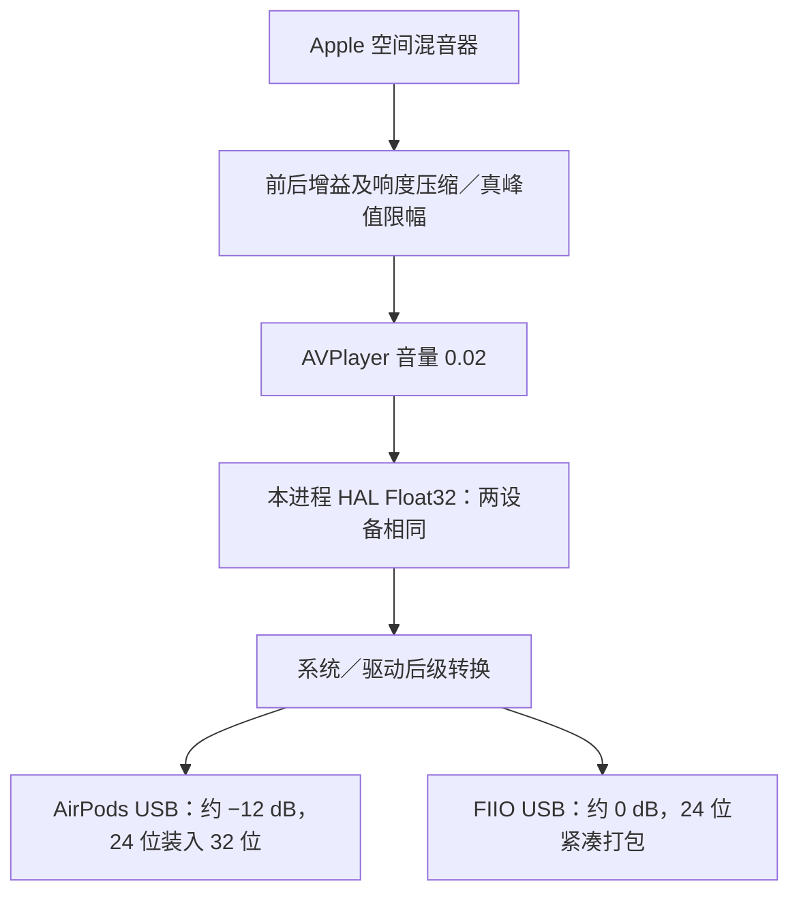

# AirPods Max／FIIO 的 USB PCM 对照

实验日期：2026-10-24。macOS 27.0.1（26A434），Apple Silicon，Wireshark／Dumpcap／Tshark 4.6.6。

**结论：匹配实际 HRTF、朝向、EQ 和处理余量后，两设备的空间混音器与本进程 HAL PCM 仍逐样本完全相同，但主机 USB 音频载荷不同。AirPods Max 的 USB PCM 相对其 HAL 输出约衰减 12 dB；FIIO 基本保持单位增益。两者还使用不同的样本容器和量化方式。不能把此前的 HAL 一致扩展为最终 USB PCM 一致。**

## 观察位置与条件



- 正常运行独立 AVPlayer 探针，同步保存空间混音器、HAL 和对应 USB 设备的传输。AirPods 使用原生路径，FIIO 使用项目原有兼容层和正式高级设置模块；没有向系统服务注入代码。
- 空间对照均明确请求并核实实际通用 HRTF；朝向固定为 0° 或 45°，播放器音量 0.02。全局个性化档案保留，没有写播放器偏好或改变系统默认输出。
- 复用高峰值 5.1 与本机 Atmos、APAC 16 声道素材；音乐取 30–37 秒，测试信号取 0–8 秒。关闭空间音频控制组使用同一确定性双声道 PCM。
- 在本机 `XHC2` 上按设备位置 ID 做内核 BPF 筛选，排除其他 USB 设备；分析再限定设备地址、端点、ISO 类型和完成事件。实际 AirPods `0x05 OUT` 载荷与本轮 HAL 波形对应，确认是 USB 音频，不根据 CoreAudio 的 `blue` 标签推断链路。
- 通过 IOKit 读取 USB 配置描述符，结合协商物理格式和载荷长度确认格式。AirPods 的 CoreAudio 物理格式为 Float32，其 USB 描述符却为 24 位有效数据、四字节容器；不能直接把前者当作线上格式。
- 临时将 FIIO 从原来的 16 位切为 24 位，并测试 AirPods 主音量标量原值与 1；每次结束均恢复并读回确认。

## USB 格式

| 项目 | AirPods Max USB Audio | FIIO KA11（24 位对照） |
|---|---|---|
| 音频 OUT／反馈 IN | `0x05`／`0x85` | `0x03`／`0x84` |
| USB Audio 接口／备用设置 | 4／1 | 2／2 |
| 采样率／声道 | 48 kHz／2 | 48 kHz／2 |
| 有效位宽／每样本容器 | 24 位／4 字节，低 8 位为零 | 24 位／3 字节 |
| 常见 8 ms 传输载荷 | 3072 字节 | 2304 字节 |

FIIO 原始备用设置为 2／1，16 位、两字节容器，常见载荷 1536 字节。按描述符解码有符号小端 PCM，去除填充位后归一化至相同满幅。比较的是音频样本，不是包头、分包边界或整个 pcap 文件字节。

## 完成的主对照

以下六组，两端实际 HRTF 均为通用。空间混音器与 HAL 全部样本相同，最大误差为 0；USB 原始样本均不相同。

| 条件 | HAL 比较帧数 | USB 比较帧数 | USB 幅度差，FIIO／AirPods |
|---|---:|---:|---:|
| 高峰值 5.1，余量 0 dB | 315,072 | 317,704 | +12.0004 dB |
| 高峰值 5.1，余量 20 dB | 314,560 | 317,761 | +12.0003 dB |
| 高峰值 5.1，余量 7.3 dB | 315,072 | 317,761 | +12.0003 dB |
| Atmos，余量 20 dB | 266,944 | 270,525 | +12.0005 dB |
| APAC 16 声道，余量 20 dB | 266,944 | 270,120 | +12.0005 dB |
| EQ＋固定 45°，余量 7.3 dB | 315,072 | 317,748 | +12.0004 dB |

幅度差来自一个左右耳共用的增益拟合，仅用于描述差异，不用于判定相同。USB 含额外传输前后段，公共窗口帧数与 HAL 不完全相同。所有比较只做两耳共用的整数偏移，固定去除起始 1 秒与末尾 0.5 秒，没有重采样、时间拉伸、独立耳间延迟或频响修正。

逐次核对 HAL → USB：AirPods 按固定 **−12 dB** 后向零截断至 24 位预测，每个已比较样本与载荷最多相差 **1 个 24 位量化步长**（归一化值 `2^-23`），不需要拟合增益。FIIO 24 位按单位增益、舍入至 24 位预测，最大也相差 1 个量化步长；关闭空间音频的立体声组与预测完全相同。浮点转换及舍入的具体实现尚未逐条定位。

扣除共同增益后，两设备 USB 差分仍非零，六组残差为相对 FIIO 信号 RMS 的 −81.48～−88.81 dB；不是 dBFS，也不是可闻性结论。结果支持本轮差异主要表现为后级增益与量化，没有把校正后的近似相同标记为逐样本一致。

## 完成的控制组

| 控制 | 结果 |
|---|---|
| AirPods 主音量标量约 0.23622 → 1，相同高峰值 5.1、20 dB 余量 | 空间混音器、HAL 与 USB 分别完全相同；USB 比较 318,517 帧。本轮 −12 dB 不随此参数改变，不能据此判断耳机内音量或实际声压。 |
| FIIO 16 → 24 位，相同素材与设置 | 空间混音器、HAL 完全相同；USB 最大样本差 `1.52587890625e-5`。仅改变量化位宽即可产生差异。 |
| 关闭空间音频，双声道 PCM | 无空间混音器；HAL 的 314,560 帧完全相同。USB 的 316,988 帧仍不同，FIIO／AirPods 约 +12.0003 dB。该差异不是本次空间混音器或高级余量设置产生的。 |

共完成 **16 次同步采集、9 组比较**，提取 15,758 次完整成功 ISO 音频传输、6,051,049 个双声道音频帧。有效段 USB 帧序列连续、载荷长度吻合，各次 Dumpcap 丢包数为 0。停流后的取消事件不拼入音频；有效段内的失败帧、缺口、重复或截断会使分析拒绝该段。

## 结论边界与产品含义

此前“相同 HRTF＋朝向＋前后增益 → 空间混音器／本进程 HAL 完全一致”仍成立。本次发现 AirPods 当前 USB 模式在 HAL 之后另有约 −12 dB 的数字幅度变化，即使空间音频关闭也存在。具体系统组件及设计原因尚未定位。

高级设置继续控制空间渲染与动态处理前后的余量。本轮没有给产品增加 USB 增益补偿，也不据此自动加 12 dB：主机传输幅度不能单独决定耳机内部处理、音量和最终声压。

这是本机、上述素材及当前 USB 模式下的主机传输载荷验证，不是外接 USB 硬件分析仪测量，未测量耳机内部 DSP、DAC 或声学输出，也不外推至蓝牙和其他系统／设备。

## 工具与复现

工具仅位于 `Tests/`，正式播放器未加入 PCM 抓取功能，产品源码未改动：`usb_audio_metadata.m` 读取设备音量、物理格式及 USB 描述符；`usb_audio_comparison.py` 同步采集并恢复设置；`usb_audio_analysis.py` 校验传输、重建 PCM 并分别报告原始差分与增益诊断。

```sh
zsh Tests/usb_audio_probe_build.sh
python3 Tests/usb_audio_analysis_test.py
build/tests/route-probe/route-probe --devices
build/tests/route-probe/usb-audio-metadata

# 替换实时 UID、素材路径及 USB 控制器接口；位宽仅在本次测试期间改变。
python3 Tests/usb_audio_comparison.py new-fiio FIIO_UID shim \
  --usb-product 'FIIO KA11' --interface XHC2 --bits 24 \
  --media /path/to/test.wav --headroom 20
python3 Tests/usb_audio_comparison.py new-airpods AIRPODS_UID native \
  --usb-product 'AirPods Max USB Audio' --interface XHC2 \
  --media /path/to/test.wav --headroom 20
python3 Tests/usb_audio_analysis.py new-airpods new-fiio \
  --pair new-pair new-airpods new-fiio

# 离线重算本次已保存的完整实验，不播放声音、不改设备设置。
python3 Tests/usb_audio_analysis.py --completed-suite
```

本机原始 `.pcapng`、HAL／空间混音器 `.f32`、提取的 `.usb.raw`、描述符、设置快照及完整指标位于被 Git 忽略的 `Artifacts/usb-comparison/`；主要结果为 `summary.json`，有效性断言和文件哈希为 `validation.json`。复用音乐原路径，不复制素材；不建立独立大型构建缓存。

Darwin USB 头及 ISO 记录解释参照 [Wireshark 4.6.6 官方解码器](https://github.com/wireshark/wireshark/blob/v4.6.6/epan/dissectors/packet-usb.c)和[字段说明](https://www.wireshark.org/docs/dfref/u/usb.html)。本次普通用户已能直接抓取，没有修改权限或运行常驻提权服务。
