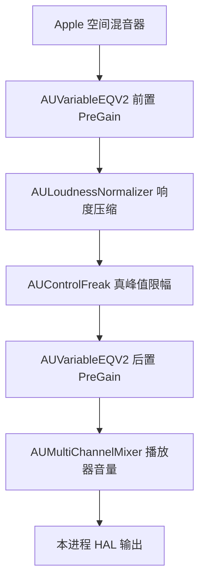

# 架构

[返回 README](../README.md)

本文讲代码怎么组织、构建产物里有什么。界面行为见[用户手册](MANUAL.md)，测试与实验见[测试说明](../Tests/README.md)。

## 模块

- `PlayerModel` 管理单个 AVPlayer、多份命名列表、加载、定位及切换；浏览列表与播放列表分别记录。`PlaybackOrder` 独立决定自动续播、手动切歌和随机历史；`PlaybackSession` v2 保存列表集合并兼容迁移 v1。generation 与 seek serial 拒绝旧异步回调；音频输出始终由 `audioOutputDeviceUniqueID` 指定。
- `AudioDeviceCatalog` 枚举输出，并监听设备列表、默认输出、存活状态和流配置。保存的是 UID，不是易变的 AudioObjectID。
- `SpatialShimSetConfiguration(deviceID, enabled)` 用单个原子状态设置目标，仅拦截该设备的 `AudioObjectHasProperty`、`AudioObjectGetPropertyDataSize`、`AudioObjectGetPropertyData`。原始能力查询从动态库内调用原始 API，避免把自己的伪装误认为硬件能力。
- 音频解码和空间渲染由 AVPlayer / MediaToolbox / AudioToolbox 完成；参数 EQ 在本进程 AUSpatialMixer 的 PostRender 中处理最终双声道 PCM，不增加音频中转队列。
- PoseBridge OSC 在独立串行队列上解码、校验时效及处理来源／会话变化；按 `posebridge.yxz.v1` 还原物理旋转，再生成世界到头部的四元数。回正、会话对齐不修改源数据或设备配置。
- `HeadPose.c` 仅跟踪本进程的 Apple AUSpatialMixer，替换其朝向设置，并在渲染前通知中读取原子姿态快照。因此普通耳机不依赖 AirPods 的系统头追回调。音频线程不解析网络、不分配内存或写日志；混音器销毁时注销通知。
- `RenderConfiguration.c` 与现有 AudioUnit 生命周期入口协作，按当前播放代次和成功建立的连接识别完整动态处理链，成对设置前后增益，校验后才标记生效；HRTF 请求与实际状态分别记录。默认不覆盖系统参数。配置和查询在控制线程进行；实时路径仅做有界原子访问，恢复失败时将受影响链静音并重建为系统处理。
- `Equalizer.c` 在非实时线程按实际采样率生成系数，通过三个带读者计数的槽发布不可变快照；实时线程做有界读取，独立保存每个实例／声道的双精度滤波状态。定位、重建、采样率变化和 AudioUnit reset 清理历史，静音时保留应有的滤波尾音。格式或参数不可用时旁路整个 EQ，并暴露实际生效状态。

## 渲染链

空间渲染之后，Apple 在本进程内依次经过以下节点再交给 HAL。`RenderConfiguration.c` 识别的就是 `SpatialMixer → vrq2 → ldnm → cfrk → vrq2` 这条唯一完整路径：



参数 EQ 和头追都挂在空间混音器上，位于这条链的起点；处理余量设置的是两个 PreGain。各级数值与实测见[进程内对照](../Tests/ROUTE_COMPARISON.md)。HAL 之后的系统／驱动转换不在本进程内，应用不观察也不修改；实测差异见 [USB PCM 对照](../Tests/USB_AUDIO_COMPARISON.md)。

## 构建产物

- 工程配置以 `project.yml` 为准，生成的 `.xcodeproj` 不提交到 Git。`SpatialUnlockPlayer` scheme 默认以 Debug 配置运行，Archive 使用 Release；`SpatialUnlockPlayer-Diagnostics` scheme 使用 Diagnostics 配置。XcodeGen 配置字段见[官方说明](https://github.com/yonaskolb/XcodeGen/blob/2.44.1/Docs/ProjectSpec.md)。
- 应用依赖独立的 `SpatialShim` 动态库 target，Xcode 负责链接、嵌入与签名。`libSpatialShim.dylib` 放在应用的 `Contents/Frameworks` 中，通过 `@rpath` 正常链接，在启动期加载。双击启动不需要环境变量。
- `build.sh` 导出的 Release 保留 ad hoc 签名，剥离本机构建路径和局部调试符号，不注入调试权限，并在应用内附带 MIT 许可证。导出时 `Scripts/check_release.py` 使用系统 Python 3 标准库检查签名、权限、构建路径和诊断入口。
- 各配置的 Xcode 构建产物位于 `build/Products`，保留本地调试信息；用于分享的版本为根目录导出的应用。构建使用 Xcode 默认的 DerivedData 位置和系统共享模块缓存；仓库内不创建 DerivedData 或模块缓存目录，也没有第三方包依赖。
- 不开启 App Sandbox / Hardened Runtime，未进行商店发布或公证。`codesign --verify` 检查包完整性，不代表已通过 Apple 公证。
- 应用标识符沿用 `local.sakuzy.SpatialPlayer`，以继续使用更名前保存的播放列表和设置。

## 诊断构建

```sh
zsh build.sh --diagnostics
```

Diagnostics 配置为 Swift 与 C 两个 target 同时启用 `SPATIAL_DIAGNOSTICS`，增加只读 AudioQueue 属性记录及本地回归脚本入口，不修改队列参数或音频样本。PoseBridge 的姿态接入属于正式功能，两种构建均包含。详细用法见[测试说明](../Tests/README.md)。交付前重新运行不带参数的 `build.sh`，导出不含测试入口与队列诊断钩子的 Release 版本。

## 应用图标

图标使用白底蓝色扁平开锁图形，资源位于 `Resources/Assets.xcassets/AppIcon.appiconset`，由 Xcode 编译打包。矢量绘制源在 `Scripts/generate_app_icon.swift`；修改后可复用系统模块缓存重新生成全部 macOS 图标尺寸：

```sh
xcrun swift -module-cache-path "$HOME/Library/Developer/Xcode/DerivedData/ModuleCache.noindex" Scripts/generate_app_icon.swift
```
